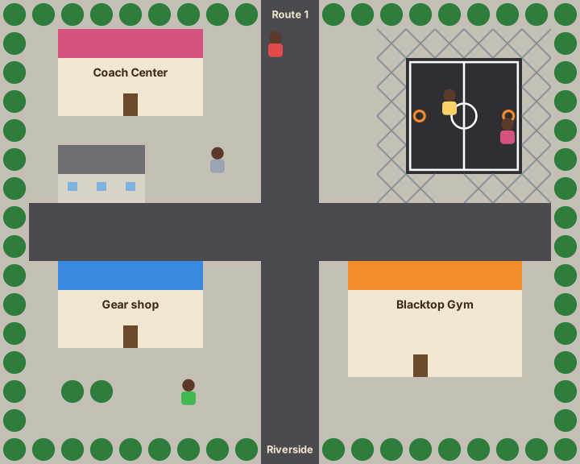
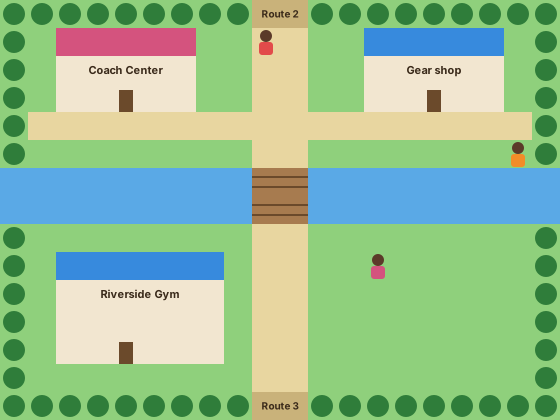
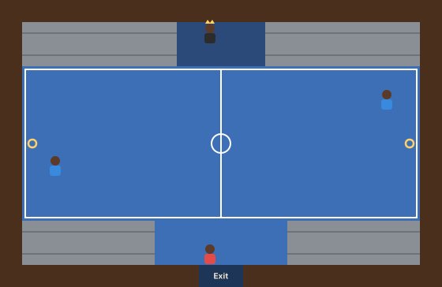

# Court Legends

A Pokémon-style basketball RPG built entirely in **R + Shiny** by Qumonie Knox.

Walk around a retro tile world, battle streetballers and gym leaders in turn-based 1v1 games, level up with no stat cap, recruit wild creatures and build a squad.

## How to play

1. Install [R](https://cran.r-project.org/) and [RStudio](https://posit.co/download/rstudio-desktop/).
2. In the RStudio Console run `install.packages("shiny")` once.
3. Open `app.R` and click **Run App**, or run `shiny::runApp("path/to/court-legends")`.

**Controls:** arrow keys or WASD to walk, Space or Enter to talk. There's also an on-screen D-pad.

## Features

- **Overworld:** Rookie Town, Route 1, Blacktop City, Route 2 and Riverside, with tall grass for wild battles
- **Turn-based basketball battles:** offense (Jumper, Three, Drive, signature moves) and defense (Contest, Block, Steal), with rebounds and stamina
- **Two gyms:** Splash (shooting) and Blur (speed), each with its own playstyle to read and a badge to earn
- **Progression with no cap:** stats grow from what you practice; each point costs more the higher it gets
- **Recruiting and squad:** beat wild creatures, try to recruit them, swap your active creature at any Coach Center
- **Coins and gear shop:** Speed Shoes, Shooter Sleeve, Lockdown Gloves, Headband, Gatorade
- **Save files:** progress saves automatically after every battle

## Creatures

| Creature | Style | Signature move |
|---|---|---|
| Blazehoop | Shooter | Deep Three (4 pts) |
| Dunkadon | Big defender | Posterizer (drains stamina) |
| Swishtail | Fast slasher | Ankle Breaker (ignores defense) |
| Rimrattler | All-rounder (wild) | Bank Shot |
| Glasshog | Rebounder (wild) | Putback Slam |
| Zoomander | Speedster (wild) | Blur Step |

## Under the hood

- The world maps are character grids in R; each letter is a tile drawn as SVG.
- Every shot is a probability computed from the two creatures' stats, then rolled with `runif()`.
- Game state lives in Shiny `reactiveValues`; progress is saved with `saveRDS()`.
- Gym difficulty was tuned by simulating hundreds of battles in R.

## Roadmap

- 2v2 up to 5v5 using your squad
- More routes, towns and gyms
- Works offline in the browser (Shinylive) and on phones